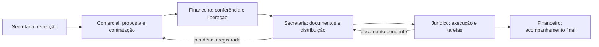

# Advpotapp — desenho da aplicação

Versão 1 · 24/11/2026 · Desenho de referência. Atualização: usuário autorizou a fundação M1 com Django/HTML/HTMX/PostgreSQL; evidências em ../testing/M1_VERIFICATION.md. Regras e módulos seguintes continuam propostas; o desenho sozinho não comprova disponibilidade.

## 1. Intenção e sucesso

Criar uma aplicação web interna para a Delfino que acompanhe a demanda do primeiro contato até execução e encerramento, unindo responsabilidade, documentos, tarefas e visão financeira autorizada.

Sucesso inicial: a equipe consegue identificar quem está com a demanda, o próximo passo e as pendências, sem duplicar cadastros ou interpretar entrega de tarefa como prazo fatal. O gestor enxerga filas entre setores. O responsável jurídico encontra o contexto do caso e os documentos autorizados.

Objetivos: aderência ao fluxo fotografado, integração Workspace em etapas, operação em VPS e dados exportáveis. Fora da primeira versão: SaaS multiempresa, cobrança do produto por assinatura, portal público do cliente, captura judicial, cálculo processual automático, integração bancária, WhatsApp automatizado e IA obrigatória.

Evitar como falhas de produto: parecer completo quando módulos são simulados; exigir pagamento integral em todo atendimento; ocultar pendências entre setores; depender da disponibilidade do Google para salvar uma tarefa; abrir todos os casos a todo usuário.

## 2. Abordagens e recomendação

**Aplicação interna em monólito modular — autorizada para M1.** Um projeto, módulos por domínio e banco relacional. Menos componentes para operar e uma transação pode registrar a mudança de etapa e o histórico juntos. Autorização de início após recomendação explícita da stack; não aprova automaticamente as regras dos módulos M2–M6.

**Frontend separado e API dedicada.** Permite evolução independente e múltiplos consumidores, mas adiciona contratos, publicação e testes entre camadas. Reservar se houver necessidade concreta de aplicativo móvel ou equipe frontend independente.

**SaaS multiempresa.** Exigiria isolamento, provisionamento e regras comerciais adicionais. Ficou fora da primeira versão após a confirmação do usuário sobre começar pela Delfino.

Stack recomendada: Django, templates HTML, HTMX para atualizações parciais, CSS com tokens e componentes próprios, PostgreSQL e implantação em contêineres na VPS. Dependências e versões suportadas devem ser confirmadas e fixadas no começo da implementação. Detalhes e alternativas em [decisões](../architecture/DECISIONS.md).

## 3. Domínios e navegação

| Área | Responsabilidade | Primeira disponibilidade proposta |
| --- | --- | --- |
| Meu trabalho | Minhas tarefas, entregas e pendências; lista e quadro | Lote inicial |
| Atendimento | Triagem, oportunidade, proposta, contratação e fila de passagem | Lote inicial |
| Clientes e contatos | Pessoa/organização, canais, vínculos e alerta de duplicidade | Lote inicial |
| Casos e processos | Caso administrativo/consultivo/judicial; processos opcionais relacionados | Lote inicial |
| Tarefas e prazos | Entrega, estado, responsável, prioridade e prazo fatal separado | Lote inicial |
| Documentos | Checklist e referências controladas; conexão real Drive em marco próprio | Inicial + Workspace |
| Agenda | Compromissos internos; publicação Calendar em marco próprio | Inicial + Workspace |
| Financeiro | Conferência/liberação no fluxo; contratos, parcelas e recebimentos no marco gerencial | Inicial + financeiro |
| Gestão | Filas por setor, pendências e indicadores com definição | Operacional inicial; BI posterior |
| Administração | Usuários, perfis, parâmetros, acesso e trilha | Fundação |

Sem botões que simulem salvar ou enviar. Uma função futura aparece como indisponível com explicação, ou fica fora da navegação até o marco correspondente.

## 4. Fluxo principal

O diagrama é um fluxo recomendado baseado na fotografia. Retornos, exceções e atendimentos urgentes precisam de validação. Encerramento jurídico e liquidação financeira são dimensões distintas.

Cada passagem registra origem/destino, responsável atual, checklist, pendências, quem encaminhou e data. O destinatário aceita ou devolve com motivo. Ao encaminhar, a fila de destino fica responsável pelo recebimento; na aceitação, um usuário ativo assume o trabalho. Não deixar itens sem responsável identificável. Atualização usa controle de versão para evitar dupla aceitação concorrente.

**Convivência de setores — proposta para validar:** manter uma passagem ativa por demanda na trilha operacional principal. Acompanhamento financeiro é uma trilha paralela e não toma a responsabilidade do jurídico. A unicidade e a concorrência são verificadas por demanda e trilha; não permitir duas passagens operacionais ativas por acidente. Essa decisão ainda precisa de validação operacional antes do lote M2.

Não criar um segundo cadastro de pessoa no financeiro: a secretaria pode abrir contato mínimo e o financeiro completar/validar os dados necessários. A passagem de setor não duplica cliente nem caso.

### Estados propostos

- Atendimento: novo → em triagem → em negociação → contratado; saídas sem contratação: perdido ou cancelado, com motivo.
- Passagem de setor: preparada → aguardando recebimento → aceita; retorno exige motivo e nova passagem rastreável.
- Contratação: rascunho → condições registradas → formalizada ou cancelada. Formalização registra referência documental; assinatura eletrônica não está presumida.
- Liberação financeira: pendente → liberada ou devolvida. A liberação é manual, por perfil autorizado, com justificativa e evidência. Não equivale a marcar tudo como pago.
- Organização: pendente → em conferência → pronta para distribuição. Checklist varia por área, após validação com o escritório.
- Caso: ativo/suspenso/encerrado/arquivado. Encerrar juridicamente não apaga parcelas ou pendências financeiras.
- Tarefa: pendente/em andamento/bloqueada/em revisão/concluída/cancelada. Bloqueio e cancelamento registram motivo. Reabertura preserva conclusão anterior no histórico.

No primeiro lote, transições são comandos explícitos. Automações de criação de tarefas e avanço de etapa ficam para uma extensão aprovada, evitando efeitos ocultos.

**Pendência financeira após liberação — proposta para validar:** nova pendência não revoga silenciosamente a liberação histórica nem bloqueia tarefas e prazos. Financeiro registra pendência e solicita decisão; eventual suspensão do caso depende de comando jurídico/gestão autorizado, com motivo e avaliação das obrigações abertas. A regra deve ser confirmada pela cliente antes de M2; não implementar suspensão automática por inadimplência.

## 5. Domínio e invariantes

**Contato:** pessoa ou organização, canais de contato, origem, responsável e estado cadastral. Identificação pessoal opcional até a etapa em que o fluxo exigir; verificar formato quando preenchida. Homônimo não é duplicado comprovado. União de duplicados não será ação automática.

**Atendimento/oportunidade:** vinculado ao contato, área de interesse, responsável comercial, próximo passo, etapa e previsão de honorários. Honorários previstos não geram recebimento, cobrança ou contrato automaticamente.

**Caso:** demanda jurídica após contratação, ou abertura excepcional autorizada. Participantes possuem papel; pode haver múltiplos clientes/partes. Processo judicial é entidade opcional vinculada ao caso, não requisito para existir tarefa ou consultoria.

**Tarefa:** pode pertencer a caso, atendimento ou atividade interna. Assignee ativo obrigatório em tarefas novas; criador e histórico são preservados. Data de entrega é data civil local; tarefa só está atrasada se não concluída/cancelada e a entrega for anterior à data de referência. Vencer hoje não significa atraso. Prazo fatal é registro separado, validado por profissional.

**Prazo fatal:** data, origem, caso/processo quando houver, responsável e confirmação explícita. Nunca calculado a partir da data de tarefa. Mudanças e conclusão auditadas. Não calcular dias úteis ou feriados neste escopo.

**Compromisso:** início/fim com fuso, responsável e vínculo opcional; horários persistidos de forma inequívoca e apresentados em America/Sao_Paulo por padrão. Não alterar datas civis de entrega por conversão de fuso.

**Financeiro:** liberação operacional, previsão de honorários, contrato, parcela e recebimento são conceitos diferentes. No marco financeiro, dinheiro usa decimal e moeda explícita; não somar valores de moedas diferentes. Pagamento parcial e estorno são registros históricos, não sobrescrita do valor contratado. Critérios de liberação são decisão do escritório.

**Documento:** metadados, classificação, vínculo e localização. Arquivo e acesso reais só são afirmados após verificação. Checklist completo não é prova automática de validade jurídica do conteúdo.

**Auditoria:** autor, ação, entidade, identificador, data e alterações relevantes; sem segredos nem reprodução indiscriminada de conteúdo. Histórico não pode ser editado por usuários comuns. Política de retenção definida antes da produção.

## 6. Perfis e acesso

| Papel proposto | Escopo padrão | Restrição relevante |
| --- | --- | --- |
| Secretaria | Contatos, recepção, organização e distribuição autorizada | Não consulta valores/recebimentos por padrão |
| Comercial | Atendimentos, propostas e condições negociadas | Não registra recebimentos nem administra acesso |
| Financeiro | Contratos, liberação e movimentações autorizadas | Não ganha acesso irrestrito ao conteúdo jurídico |
| Jurídico | Casos atribuídos, tarefas e documentos permitidos | Não registra pagamento ou altera perfil |
| Gestão | Visão por setores e indicadores permitidos | Caso restrito exige concessão explícita |
| Administração técnica | Configuração e operação técnica | Acesso a dados de negócio deve ser excepcional e registrado |

Matriz proposta, não aprovada pela cliente. Separar permissão de administrar infraestrutura de consultar dados. A conta técnica cotidiana não usa superusuário. Acesso emergencial tem justificativa, prazo e auditoria. Usuário inativo perde sessão e novas atribuições; histórico permanece.

Verificar autorização em detalhe, lista, busca, exportação, painel e arquivo. O resultado de contadores não pode revelar casos fora do escopo do usuário.

Em filas de casos restritos, a proposta é mostrar a quem está autorizado apenas a receber a passagem uma referência interna opaca, setor e situação; não revelar nome do cliente, título, checklist ou justificativa sensível sem concessão. A aceitação e o detalhamento exigem escopo explícito para aquela ação. Validar quais metadados cada setor realmente precisa; não presumir que o encaminhamento abre o caso inteiro.

## 7. Experiência proposta

Interface em português, hierarquia clara, tipografia de leitura e tabela/lista como alternativa aos quadros. Direção visual inicial: fundo claro, texto escuro, verde discreto e alertas com texto/ícone; inspirada nas referências locais, não identidade visual formal aprovada.

Na página do caso: resumo, pessoas, responsáveis, pendências, tarefas, documentos, compromissos e histórico. Dados financeiros somente conforme permissão. No painel inicial: minhas entregas, aguardando meu setor e próximas ações. Gestão agregada é uma área distinta de Meu trabalho.

Filtros visíveis e removíveis; estado vazio orienta a próxima ação; formulário preserva entradas após erro; salvar informa sucesso/falha real. Mudança de etapa funciona por comando acessível, sem exigir arraste. Validar teclado, foco, contraste, mensagens e telas pequenas. Layout desktop prioritário, com listas utilizáveis no celular.

## 8. Workspace

**Drive:** primeiro vincular documentos existentes e criar pastas apenas no local autorizado. Metadados no Advpot; conteúdo no Drive. Preferir propriedade institucional; validar plano e possibilidade de drive compartilhado. Se indisponível, registrar alternativa institucional antes de produção. Não publicar links por padrão nem espelhar permissões automaticamente sem regra revisada.

**Calendar:** publicar compromissos selecionados do Advpot para uma agenda definida. Sem edição bidirecional inicial. Prazo fatal permanece no Advpot. Cancelamento e alteração precisam reconciliar o evento por identificador externo. Eventos iniciais sem convidados e sem envio de convites; inclusão de participantes será decisão explícita posterior.

Falha externa não desfaz tarefa/caso salvo. Usar outbox transacional e estados pendente/em processamento/sincronizado/falhou/desativado. Worker reivindica trabalho com bloqueio e expiração, tem novas tentativas limitadas, reconciliação e fila de falhas. Cada operação leva chave estável para não duplicar pasta/evento em repetição. Definir estratégia por API e testar timeout após sucesso remoto.

Autorizações e tokens fora do repositório. Validação de conta, escopos e APIs é requisito do marco Workspace; nenhuma credencial foi solicitada nesta estruturação.

## 9. Indicadores iniciais

| Indicador | Definição proposta |
| --- | --- |
| Demandas aguardando setor | Passagens pendentes para o setor, com filtros de acesso |
| Entregas atrasadas | Tarefa aberta não cancelada com delivery_date anterior à data de referência |
| Próximas ações comerciais | Oportunidades abertas com próximo passo no período |
| Pendência documental | Item obrigatório do checklist ainda não conferido; mostrar checklist aplicável |
| Casos ativos | Casos no estado ativo, não quantidade de números processuais |
| Recebíveis em aberto, marco financeiro | Valor da parcela menos recebimentos líquidos reconhecidos, sob moeda e período definidos |

Exibir filtro, data de referência e atualização. Não inferir conversão, estagnação, produtividade temporal ou atraso de conclusão da base sintética sem eventos/datas correspondentes.

## 10. Persistência, entrega e operação

Modelo próprio descrito no contrato de dados. Banco não exposto publicamente. VPS com proxy HTTPS, aplicação, PostgreSQL e worker do mesmo projeto; cópias externas e monitoramento. Sem pressupor alta disponibilidade em uma VPS única. Políticas de recuperação e suporte dependem de acordo e ensaio.

Estrutura futura sugerida, ainda não criada: `app/config`, `app/modules/{identity,contacts,intake,cases,work,handoffs,documents,finance,integrations,audit}`, `app/templates`, `app/static`, `tests`, `ops`, `docs`. Separar regra de negócio de view e integração de provedor. APIs próprias só onde houver consumidor; nunca usar endpoints internos da ADVBOX como dependência.

## 11. Sequência e conclusão

Fundação → fluxo interno completo → Drive/Calendar → financeiro gerencial → piloto/migração autorizada → produção. Passagens e liberação manual entram antes do financeiro completo para não apagar o fluxo real do escritório.

Um lote fica pronto para homologação após seus testes e evidências. Só fica disponível após aceite e publicação no ambiente acordado. Primeiro lote não permite prometer substituição integral do sistema atual. Ver [roteiro](../delivery/BUILD_ROADMAP.md), [aceite](../testing/ACCEPTANCE.md) e [decisões pendentes](../decisions/OPEN_QUESTIONS.md).
