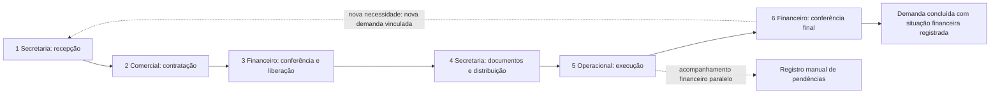

# M2 — fluxo e pipelines da Delfino

25/11/2026 · Desenho v1 aprovado pelo usuário para construção do M2-A; demais lotes planejados e homologação pendente. Pedido do usuário: usar o fluxograma fornecido pela cliente para criar as regras do M2 e construir fluxo/pipelines. Fonte de processo definida pelo usuário; critérios adicionais abaixo são propostas do Advpot, não confirmações atribuídas à cliente.

## 1. Objetivo, fronteira e estágio

Problema: a demanda pode perder contexto ou responsável quando passa de secretaria a comercial, financeiro e operação. Usuários: essas equipes e a gestão autorizada. Resultado: localizar a mesma demanda, seu próximo passo, pendências e responsável em qualquer etapa, com histórico de passagens e acesso restrito.

Entrada: secretaria registra uma demanda vinculada a contato. Saída operacional: serviço concluído explicitamente pelo jurídico e conferência final registrada pelo financeiro. Encerramento jurídico e situação financeira permanecem independentes.

Referências: [leitura da imagem](../../context/DELFINO_FLOW_EVIDENCE.md), [desenho geral](../../specs/ADVPOTAPP_DESIGN.md), [contrato de dados](../../data/DATA_CONTRACT.md), [decisões M1](../../architecture/DECISIONS.md).

Estado desta entrega: regras e pipelines especificados; nenhum comando, modelo, formulário ou migração M2 implementado por este documento. M1 continua com acesso, auditoria e envelope mínimo de caso, sem fluxo operacional completo. Regras propostas passam a aprovadas após revisão explícita do desenho; disponibilidade depende de testes, homologação e publicação no ambiente acordado.

## 2. Abordagem e alternativas

**Abordagem recomendada:** uma demanda central e pipelines conectados como visões da mesma jornada. Preserva as seis etapas da foto e o monólito Django/HTML/HTMX/PostgreSQL já autorizado. Transições são comandos explícitos, com pré-condições e histórico.

Alternativa: um único quadro com colunas livres. É simples de desenhar, mas mistura negociação, conferência e execução e facilita avanço sem entrega correta. Alternativa: um cadastro independente por setor. Foi descartada para este desenho porque duplicaria cliente/contrato/caso e contrariaria a continuidade exigida em IMG-07.

A imagem fornecida pelo usuário define o caminho de negócio. A organização em visões conectadas é uma escolha proposta do agente para materializá-lo; não foi apresentada como decisão prévia da cliente. Sem framework adicional de workflow, frontend separado, broker ou mudança de stack.

## 3. Fluxo principal e responsabilidades

Os seis blocos vêm de IMG-01–06. Acompanhamento paralelo, conclusão explícita e nova demanda vinculada são propostas para preservar responsabilidades sem interpretar a seta de retorno como reinício automático.

| Etapa | Responsável | Entrada mínima proposta | Entrega necessária para encaminhar | Fonte |
| --- | --- | --- | --- | --- |
| Recepção | Secretaria | Contato mínimo, descrição da necessidade, origem, área inicial ou “a classificar”, responsável ativo | Necessidade descrita; contato utilizável ou ausência justificada; relação dos documentos recebidos/pendentes; próximo passo | IMG-01 + regra proposta |
| Comercial | Comercial | Demanda recebida explicitamente | Solução/serviço descrito, honorários/condições registrados, contratação formalizada e referência documental | IMG-02 + regra proposta |
| Financeiro inicial | Financeiro | Contratação formalizada e cadastro reutilizado | Conferência registrada; decisão manual liberada, com autor, motivo e referência da evidência; nenhuma quitação automática | IMG-03 + AGENTS + regra proposta |
| Organização/distribuição | Secretaria | Liberação válida para a versão atual da contratação | Cadastro revisado, checklist conferido ou exceção autorizada, localização documental manual, responsável jurídico ativo e acesso operacional explícito | IMG-04 + regra proposta |
| Execução | Operacional/jurídico | Caso e contratação vinculados, responsável e acesso concedidos | Análise e providências registradas; tarefas e prazos tratados; resultado do serviço e pendências de encerramento explicitados | IMG-05 + regra proposta |
| Financeiro final | Financeiro | Encaminhamento final do jurídico | Conferência manual: sem pendência registrada ou pendência/escalonamento; decisão explícita sobre acompanhamento; não recalcular parcelas/recebimentos | IMG-06 + limite M4 |

O cadastro feito pelo financeiro complementa o contato existente; não cria outra pessoa por mudança de etapa. Conferir documentos não comprova validade jurídica nem acesso Google. Comunicação de pendência no M2 é um registro interno, sem envio externo.

## 4. Pipelines e unidades dos cartões

Nenhum quadro tem banco/cadastro independente. A demanda aparece na etapa principal atual e nas visões auxiliares permitidas; somar cartões entre visões não representa total de clientes ou casos.

| Visão | Colunas fixas propostas | Cartão e regra |
| --- | --- | --- |
| Jornada da demanda | Recepção → Comercial → Financeiro inicial → Organização/distribuição → Execução → Financeiro final; finalizadas em filtro separado | Uma demanda; mostra etapa, responsável, próximo passo e pendência autorizados |
| Atendimento comercial | Triagem → Diagnóstico → Proposta → Formalização; Contratado/Perdido/Cancelado em filtros finais | Mesma demanda + oportunidade; contratação formalizada permite pedir passagem ao financeiro |
| Preparação operacional | Conferência financeira → Aguardando liberação → Conferência documental → Pronta para distribuição; encaminhadas em filtro separado | Mesma demanda; decisão financeira e checklist são entidades separadas da coluna |
| Execução jurídica | A analisar → Em execução → Aguardando providência → Em revisão → Serviço concluído | Mesmo caso da demanda; situação jurídica ativo/suspenso/encerrado/arquivado é independente desta coluna |
| Acompanhamento financeiro | A conferir → Acompanhando → Pendência registrada → Conferência final; encerradas em filtro separado | Uma ficha manual por demanda; não representa lançamento contábil ou saldo calculado |

No quadro de jornada, pedido pendente de passagem mantém a coluna de origem com indicador “Aguardando recebimento de [setor]”. A fila do destino também referencia o mesmo pedido, sem criar segunda demanda. Só o aceite efetiva a mudança de etapa principal.

“Aguardando providência” exige motivo, responsável pela ação e próximo passo; não conclui tarefa nem suspende prazo. A ficha financeira pode continuar acompanhando enquanto o jurídico executa e depois do encerramento jurídico. A etapa final da jornada é a conferência final; pendência financeira não apaga o encerramento do serviço.

Não haverá editor livre de etapas no primeiro M2. Lista e quadro compartilham consultas/permissões; arraste nunca é obrigatório e, se habilitado depois, usa o mesmo comando do botão.

## 5. Estados separados e comandos

Rótulos abaixo são normalização proposta do Advpot, não transcrição de um software observado.

| Objeto | Estados propostos | Comandos explícitos |
| --- | --- | --- |
| Demanda | Aberta, concluída, cancelada | Abrir, concluir, cancelar com motivo; reabertura de demanda finalizada fora do primeiro M2 |
| Oportunidade | Triagem, diagnóstico, proposta, formalização, contratada, perdida, cancelada | Registrar próximo passo, apresentar proposta, registrar formalização, marcar perda/cancelamento com motivo |
| Contratação | Rascunho, condições registradas, formalizada, cancelada | Registrar condições, formalizar com referência, cancelar com motivo |
| Passagem | Aguardando recebimento, aceita, devolvida, cancelada | Encaminhar, aceitar, devolver com motivo, cancelar pedido antes do aceite |
| Liberação operacional | Pendente, liberada, devolvida | Conferir, liberar com motivo/evidência, devolver com pendência |
| Checklist | Pendente, conferido, dispensado por decisão autorizada | Conferir item ou registrar dispensa motivada; histórico preservado |
| Caso | Ativo, suspenso, encerrado, arquivado | Iniciar execução, suspender/retomar com motivo, encerrar, arquivar |
| Tarefa | Pendente, em andamento, bloqueada, em revisão, concluída, cancelada | Iniciar, bloquear, enviar para revisão, concluir, cancelar, reabrir; autoria e motivo quando aplicáveis |
| Prazo fatal | Pendente de confirmação, confirmado, concluído, cancelado | Profissional informa/confirma data e origem; conclui ou cancela explicitamente |

Etapa da jornada, status da oportunidade, situação do caso, entrega da tarefa e prazo fatal não são o mesmo campo. Um número judicial não é obrigatório para atendimento, contratação, caso consultivo ou tarefa.

## 6. Regras de passagem e concorrência

Todas as regras RP abaixo são propostas de implementação motivadas por IMG-07.

| ID | Condição | Consequência |
| --- | --- | --- |
| RP-01 | Encaminhar uma demanda aberta | Exigir origem atual, setor destino permitido, checklist de saída, próximo passo, autor, versão esperada e chave única da operação |
| RP-02 | Existe pedido aguardando recebimento na trilha principal | Negar novo encaminhamento; não permitir dois destinos principais simultâneos |
| RP-03 | Pedido criado | Responsável de origem continua responsável pela demanda; fila de destino assume a obrigação de receber, sem responsabilidade individual fictícia |
| RP-04 | Usuário ativo do destino tem ação receber concedida para a demanda | Aceite transacional transfere a etapa e o responsável; histórico registra quem encaminhou, quem aceitou e quando |
| RP-05 | Destino não recebeu informação suficiente | Devolver com motivo e pendência; etapa principal e responsável de origem são mantidos; novo pedido após correção tem novo ID |
| RP-06 | Dois usuários tentam aceitar a mesma versão | Apenas o primeiro confirma; segundo recebe conflito sem sobrescrever responsável ou duplicar histórico |
| RP-07 | Operação repetida com mesma chave, autor e conteúdo | Devolver resultado já confirmado; mesma chave com conteúdo diferente gera conflito |
| RP-08 | Falha ao persistir passagem ou histórico | Reverter toda a transação; a tela não informa sucesso parcial |
| RP-09 | Usuário/setor sem permissão ou demanda fora de seu escopo | Negar no servidor, inclusive chamadas diretas, busca, contadores e exportação |
| RP-10 | Responsável perde ação, setor ou conta ativa com trabalho aberto | Aplicar protocolo de revogação e recuperação da seção 9; nunca deixar obrigação invisível ou impedir revogação de segurança |

As transições normais são 1→2→3→4→5→6. Destino errado não é corrigido por arraste livre; cancelar pedido não aceito e reencaminhar corretamente. Uma devolução anterior ao aceite não retrocede etapa já efetivada.

Se a pendência for descoberta após o aceite, criar solicitação de correção interna vinculada e manter o responsável atual. Não haverá comando para retroceder etapa já aceita no primeiro M2: correção comercial/documental não desloca execução, não altera prazo nem apaga liberação. Alterações de condições após o início geram revisão e conferência vinculadas na trilha financeira, com escalonamento explícito, sem suspensão automática. Não implementar atalhos de urgência ou pulo de etapas sem decisão explícita.

## 7. Regras comerciais, liberação e documentos

| ID | Regra proposta | Limite |
| --- | --- | --- |
| RC-01 | Nome do contato e tipo pessoa/organização; canal opcional com ausência justificada; aviso de possível duplicidade visível somente para registros autorizados | Homônimo não bloqueia; não unir automaticamente |
| RC-02 | Toda demanda aberta possui responsável e próximo passo; usar “área a classificar” quando desconhecida | Não forçar dado inventado na recepção |
| RC-03 | Formalização exige serviço, condições/honorários em Decimal com moeda explícita, referência do contrato e autor/data | Sem assinatura eletrônica ou recebimento implícito |
| RC-04 | Reexecução da formalização/conversão reutiliza contato, contratação e caso vinculados | Relações únicas evitam duplicação |
| RF-01 | Financeiro decide liberar/devolver manualmente; liberação exige motivo e referência da conferência | Não exigir quitação integral, não registrar “pago” por inferência |
| RF-02 | Liberação vale para a versão específica da contratação conferida | Alterar condições antes da distribuição exige nova conferência; conserva liberação anterior no histórico |
| RF-03 | Nova pendência após o início da execução | Registrar e escalar ao financeiro/gestão; não bloquear tarefas/prazos ou suspender caso automaticamente |
| RF-04 | Conferência final identifica pendência | Manter acompanhamento financeiro aberto ou encerrar administrativamente com pendência aceita por gestor autorizado e motivo; nunca marcar saldo quitado |
| RD-01 | Checklist mínimo: necessidade descrita, cadastro revisado, contratação referenciada, liberação atual, inventário/localização dos documentos, responsável operacional indicado | Requisitos específicos por área serão configuração validada posteriormente |
| RD-02 | Item documental obrigatório pendente | Bloquear distribuição normal; dispensa exige ação específica da gestão, motivo e histórico do item; não dispensa contratação/liberação |
| RD-03 | Localização de documento é referência manual institucional | Não afirmar download, acesso verificado, backup ou sincronização Drive |

Caso mínimo é preparado na etapa 4, após liberação e com responsável jurídico ativo indicado, antes de enviar a distribuição. Esse preparo explícito é idempotente e não inicia a execução: conserva Case.responsible obrigatório do M1 e permite ao gestor autorizado conceder as ações necessárias ao executor antes do aceite. Na formalização, criar apenas contratação; demanda e oportunidade não precisam de caso. Iniciar execução só após liberação, documentação e distribuição aceitas. Urgência não elimina essas condições no caminho normal. A decisão sobre um procedimento excepcional deve ser validada separadamente.

## 8. Trabalho e encerramento

| ID | Condição e comportamento |
| --- | --- |
| RT-01 | Toda tarefa nova exige responsável ativo e contexto; pode ser interna, do atendimento ou do caso, sem processo judicial fictício |
| RT-02 | delivery_date é entrega combinada. Só está vencida se anterior à data local de referência e aberta; vence hoje não é atraso |
| RT-03 | Prazo fatal tem data, origem, responsável e confirmação profissional separados; não calcular a partir de tarefa, publicação ou calendário |
| RT-04 | Bloqueio/cancelamento e reabertura de tarefa conservam motivo e histórico; reabrir não apaga conclusão anterior e só é permitido com demanda aberta e caso não encerrado/arquivado |
| RT-05 | Encerrar o serviço exige resultado e zero tarefas/prazos abertos: tarefa em concluída/cancelada e prazo em concluído/cancelado. Cancelar prazo exige profissional autorizado, justificativa e evidência. Justificativa de pendência, transferência de responsável ou simples ciência não substituem estado terminal |
| RT-06 | Jurídico pode registrar serviço concluído e encaminhar ao financeiro final, sem declarar pagamento ou quitação |
| RT-07 | Finalizar demanda exige serviço concluído ou saída sem contratação documentada, nenhuma passagem principal pendente, zero tarefa/prazo aberto em qualquer contexto e decisão final autorizada sobre pendências financeiras/documentais |
| RT-08 | Nova necessidade após encerramento cria nova demanda vinculada ao mesmo contato. Correção do registro de encerramento recebe evento aditivo auditado; reabertura de demanda/caso finalizado fica fora do primeiro M2, sem apagar a conclusão anterior |

Concluir uma tarefa não avança automaticamente a etapa de um caso ou demanda. Encerrar caso não elimina saldo nem ficha financeira. Suspender caso não pausa contagem de prazo informado.

## 9. Acesso e responsabilidade

Setor descreve capacidade de agir em uma etapa; concessão por registro define sobre qual demanda/caso a pessoa pode agir. Exigir ambos em comandos operacionais. Não converter o role técnico operator do M1 em acesso geral a todos os setores.

Secretaria, Comercial, Financeiro, Operacional e Gestão são atribuições de negócio propostas, cumulativas somente quando concedidas explicitamente. Administrador de acessos e Auditor M1 permanecem papéis técnicos, sem conteúdo jurídico implícito. A matriz detalhada está em [M2_ACCESS_MATRIX.md](../../product/M2_ACCESS_MATRIX.md).

Concessão por demanda não abre automaticamente todo contato, histórico pessoal, financeiro ou outros casos. Fila de recebimento restrita só mostra referência opaca, origem/destino e situação a quem tem receber concedido naquele item; nome/título, checklist, documentos, motivo sensível e valores exigem ações próprias. Aceitar não concede leitura automaticamente. Antes da distribuição, o responsável autorizado deve conceder a leitura necessária ao executor; se não houver, o comando falha sem transferência parcial.

Busca de possível duplicidade, filtros, painéis, totais, histórico e exportações usam o mesmo escopo. Acompanhamento financeiro compartilha apenas dados necessários ao contrato e à conferência, sem abrir conteúdo jurídico.

### 9.1 Inicialização e concessão de acesso

Proposta de configuração inicial, sem inferir pessoas reais: comando interativo de uso único registra a indicação de um usuário ativo como autoridade inicial de acesso de negócio, a referência da autorização da gestão e o operador técnico executor. Ser access_admin não habilita esse poder pela interface. A autoridade inicial pode atribuir setores, delegar gestão de concessões e configurar filas de recuperação; não recebe leitura, financeiro, execução ou exportação de registros automaticamente. Configuração e delegações são auditadas. Antes do piloto, a gestão deve indicar explicitamente as pessoas autorizadas; nos testes, usar identidades fictícias próprias.

Quem recebe capacidade de criar demanda pode abrir registro novo em seu contexto de entrada. A criação concede, na mesma transação, ações documentadas ao criador: view_minimal, edit_intake, send_handoff e view_history sobre aquela demanda. Não abre contatos restritos preexistentes ou casos. Contato novo tem concessão cadastral mínima ao criador; reuso de existente exige acesso prévio. Encaminhar exige que já exista ao menos um destinatário ativo do setor destino com receive_handoff e as ações necessárias para tratar aquela passagem, concedidas por autoridade de negócio para aquele registro. Sem isso, bloquear envio e orientar a solicitar concessão. Aceite continua sem concessão automática de leitura.

### 9.2 Revogação e recuperação de responsabilidade

Retirada planejada de setor/ação exige conferência do trabalho e reassociação explícita a executor ativo com concessões suficientes. Não transferir silenciosamente tarefas ou permissões.

Revogação de segurança e desativação sempre removem o acesso na próxima requisição, mesmo com trabalho aberto. A mesma operação coloca demandas/tarefas/prazos afetados em fila institucional identificável “Gestão — recuperar responsabilidade”, conservando atribuição anterior no histórico, estados, datas e pendências. Não escolher outro usuário automaticamente. Pedidos de passagem envolvendo executor revogado ficam bloqueados para novos comandos até recuperação, sem aceite/devolução fictícios.

A fila tem capacidade específica e concessão de recuperação por registro, provisionada pela política de contingência no mesmo comando auditado. Somente gestores de recuperação designados veem os itens; quem só pode recuperar recebe referência opaca e dados mínimos, sem conteúdo jurídico/financeiro. Se todos estiverem indisponíveis, a fila continua identificada e pendente, sem restaurar acesso do usuário revogado ou abrir leitura geral à administração técnica. A autoridade de acesso de negócio pode designar substituto com auditoria.

Novas tarefas/prazos normais exigem pessoa ativa; fila é exceção de recuperação, com identidade institucional própria. Não encerrar caso/demanda com obrigação aberta na fila. Alterações de role técnico M1, setor, concessão ou is_active devem usar o mesmo comando de revogação/recuperação; revogar apenas a sessão exige novo login, sem mudar responsabilidade se a conta conserva suas ações.

## 10. Persistência e fronteiras do código

Manter M1 e evoluir por migrações incrementais. Novas entidades propostas: Contact, Demand, Opportunity, Engagement/EngagementRevision, Handoff, OperationalRelease, ChecklistItem/DocumentReference, BusinessAuthority/BusinessAssignment, DemandGrant, CaseParticipation, Task, LegalDeadline, InternalAppointment, RecoveryQueue/ResponsibilityAssignment e FinancialFollowup manual. Não criar parcelas/recebimentos M4 por inferência. Responsabilidade atual é pessoa ativa ou fila institucional de recuperação, nunca ambas ou nenhuma; preservar responsável histórico M1 e não usar Case.responsible como prova de posse da demanda/tarefa.

Demand é a identidade estável da jornada; vincula contato principal, etapa, responsável, versão e próximo passo. Opportunity/Engagement/Case referenciam Demand sem copiar dados pessoais. Contact é cadastro reaproveitado; participações permitem papéis diferentes. O comando de preparar caso na etapa 4 não cria outro caso em repetição. Uma demanda tem no máximo um caso inicial no recorte M2; múltiplos processos opcionais são vínculos do caso, não novos cartões de cliente. Separar o instante de preparação do caso e execution_started_at, preenchido somente no aceite pelo Operacional; a presença de Case não comprova liberação/início do serviço.

Handoff referencia demanda e trilha; restrição no banco para apenas um pedido principal aguardando recebimento por demanda. Aceitar/devolver: transaction.atomic, bloqueio de demanda/pedido, checagem de versão e permissão e evento de histórico na mesma transação. Chave de idempotência com autor/ação/hash do conteúdo para comandos de formalização, passagem e liberação. Caso e concessões M1 permanecem; mudança de modelo de autorização exige preservar concessões existentes e testar regressões de exportação.

Histórico de domínio registra autor, comando, IDs, versão e mudanças relevantes, com leitura conforme escopo da demanda. AuditEvent técnico M1 continua restrito ao auditor e não recebe narrativas jurídicas/valores pessoais indiscriminadamente. Cancelamentos/substituições usam novos registros ou eventos, não exclusão em cascata de histórico.

## 11. Interface e falhas

Navegação proposta: Meu trabalho; Atendimento; Clientes; Jornada/Passagens; Casos; Tarefas e prazos; Acompanhamento financeiro, conforme capacidades. Quadros com alternativa em lista, filtros removíveis, etapa atual, responsável, próximo passo e motivo de bloqueio autorizado. Detalhe com histórico e links entre demanda, contratação e caso.

Formulários preservam dados após validação; comando bem-sucedido informa a nova etapa real. Concorrência mostra “Este registro foi atualizado; recarregue para continuar”. Requisição sem acesso não revela existência de registro restrito. Sem sessão redireciona ao login, inclusive HTMX. Não guardar conteúdo jurídico em cache de histórico HTMX. Toda mutação usa POST e CSRF.

Falha de referência documental manual é marcada como pendência, sem alegar consulta ao Drive. Não há serviço externo configurado no M2; falhas de Google só entram nos testes de M3.

## 12. Entregas, dependências e aceite

| Lote interno proposto | Problema/usuário | Entrega | Dependência | Aceite |
| --- | --- | --- | --- | --- |
| M2-A | Secretaria perde contexto na entrada | Contato + demanda + triagem + pipeline comercial | Revisão deste desenho e concessões por demanda | Mesma pessoa reaproveitada; acesso alheio negado |
| M2-B | Comercial/financeiro precisam entregar condições conferidas | Contratação versionada + passagem + liberação manual | M2-A e ações financeiras | Repetição sem duplicação, liberação atual e histórico |
| M2-C | Secretaria/jurídico precisam preparar a execução | Checklist + referências + distribuição + caso | M2-B e política de executor | Documento pendente bloqueia; executor sem acesso não aceita |
| M2-D | Jurídico/gestão precisam executar e acompanhar | Tarefa, prazo informado, compromisso interno, encerramento e ficha financeira manual | M2-C | Jornada completa com devolução, concorrência, acesso negado e encerramento independente |

Ver [cenários de aceite](../../testing/M2_ACCEPTANCE.md). Todos os lotes estão propostos; sem preço/prazo fechado. M2-D é necessário para declarar a primeira jornada completa em homologação. M2-A isolado não é substituição do sistema atual.

## 13. Limites, decisões pendentes e confiança

Fora: Drive/Calendar real, Gmail, envio de cobranças/comunicações, pagamentos bancários, parcelas/recebimentos completos, integrações judiciais, cálculo automático de prazos, IA, SaaS e migração de dados. Recuperação de acesso/MFA e operação recuperável continuam requisitos anteriores ao uso real.

Alta confiança: sequência/setores e suas entregas na foto. Escolhas propostas, com confiança condicionada à revisão: aceite/devolução, etapas internas dos quadros, concessões, critérios de liberação/documentos e fechamento. Não atribuir essas escolhas à cliente.

O desenho propõe decisões concretas: liberação sem quitação obrigatória; sem suspensão automática por pendência; uma passagem principal por demanda; urgência sem atalho implícito; dados restritos por concessão; inicialização explícita de acesso de negócio; encerramento sem obrigações abertas; revogação de segurança com recuperação de responsabilidade; sem retrocesso de etapa já aceita. Revisar essas propostas em conjunto. Checklists específicos por área, homologadores e pessoas/setores concretos serão necessários antes da homologação, sem impedir a revisão deste desenho.

Revisão independente em 25/11/2026 identificou quatro lacunas relevantes, resolvidas como propostas do agente nas seções 6, 8 e 9. Não houve aprovação da cliente para essas escolhas nem implementação de código M2 nesta etapa.
